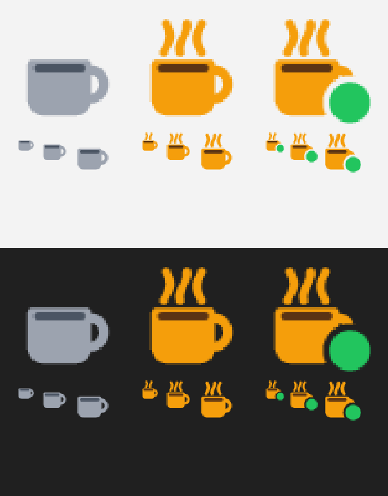

# KeepAwake

A tiny Windows tray app (~330 KB exe, ~1.5 MB private memory, near-zero CPU, no dependencies besides `windows-sys`) that stops Windows from locking or sleeping while you're idle.



The icons are drawn in code ([src/art.rs](src/art.rs)) at the exact size Windows needs, and `build.rs` embeds the same artwork as the exe icon.

## Modes

| Mode | Icon | What it does |
|---|---|---|
| Off | gray mug | Nothing. Windows behaves normally. |
| Keep screen awake | steaming amber mug | Asks Windows to keep the display and system on (`SetThreadExecutionState`). Stops screen-off, sleep and screensaver-based locks. No fake input. |
| Simulate activity | steaming mug with a green badge | Keep screen awake, plus a harmless input (F15 key, or a zero-distance mouse move) after `interval_secs` of idle time. Resets the idle timer, so it also stops idle-time locks and "Away" status in chat apps. Sends nothing while you're actively using the PC. |

## Use

- **Left-click** the tray icon: toggle between Off and the last used mode.
- **Right-click**: menu with mode, **Duration** (indefinitely, 30 min – 8 h, or until end of work hours; reverts to Off afterwards), **Work-hours schedule**, **Start with Windows**, **Edit settings…**, **Exit**.
- Hover for the current state and time left.

The mode and timer are remembered across restarts.

## Settings

`%APPDATA%\KeepAwake\config.ini` (opened by *Edit settings…*). Saved edits apply within 5 seconds.

```ini
mode=off              # off | awake | activity
until=0               # unix time to switch back to off; 0 = indefinitely
interval_secs=60      # idle seconds before simulated input (5-3600)
input=f15             # f15 | mouse
schedule_enabled=false
schedule_days=Mon-Fri # or Mon,Wed,Fri
schedule_start=08:00
schedule_end=17:00
schedule_mode=activity
```

The schedule applies only while the manual mode is **Off**: during the window it uses `schedule_mode`, outside it does nothing. Overnight windows (e.g. 22:00–06:00) work.

**Start with Windows** writes a per-user `HKCU\...\Run` entry (no admin needed). If you move the exe, toggle it off and on again.

## Build

Needs Rust (MSVC toolchain).

```bash
cargo build --release
```

Output: `target\release\keepawake.exe`. Copy it anywhere, run it, and enable *Start with Windows* from the menu.

## Limits

- Windows **Dynamic Lock** (locks when your phone's Bluetooth goes away) and **presence sensing** (locks when a laptop sensor sees you leave) don't use the idle timer, so this app can't stop them. Turn them off in Settings → Accounts → Sign-in options / Privacy & security → Presence sensing.
- If your organization requires the screen lock on this device, check that this is allowed before using it.

## License

[MIT](LICENSE)
